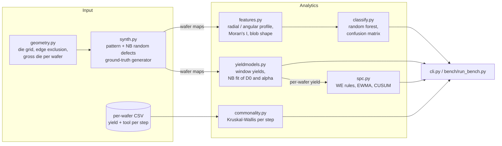

# waferyield

Yield analytics for semiconductor wafer test data, in Python. It takes
wafer maps (pass/fail per die from wafer sort) and per-wafer process history,
and answers four questions a yield engineer asks:

1. **What spatial defect pattern is on this wafer?** Center, donut, edge-ring,
   edge-loc, local cluster, scratch, random, or none. Classified from 20
   hand-built spatial features with a random forest.
2. **What is the defect density, and how clustered are the defects?**
   Fits the negative binomial (Stapper) yield model with the window method,
   which separates defect density D0 from the cluster parameter alpha, and
   compares it with Poisson, Murphy and Seeds.
3. **Has the line shifted?** Shewhart charts with Western Electric rules,
   EWMA and CUSUM on per-wafer yield, with control limits from a Phase-I
   baseline.
4. **Which tool did it?** Equipment commonality analysis: Kruskal-Wallis
   test per process step across tools/chambers, ranked, with Bonferroni
   correction and the worst tool's median yield gap.

There is no public fab data shipped here. Everything is tested and
benchmarked against a synthetic generator with known ground truth (see
Limitations).

## Quick start

```bash
python -m venv .venv && . .venv/bin/activate
pip install -e ".[test]"
pytest -q                          # 46 tests
python bench/run_bench.py --quick  # ~3 s, what CI runs
python bench/run_bench.py          # full benchmark, ~80 s, writes bench/results.json
```

CLI:

```bash
waferyield show scratch --seed 2                     # render a synthetic wafer map
waferyield fit-yield --d0 0.3 --alpha 2 --wafers 500 # simulate a lot, fit yield models
waferyield commonality wafers.csv --yield-col yield --steps litho etch cmp
```

`commonality` works on any CSV with one row per wafer, a yield column and one
column per process step naming the tool used.

Example output of `waferyield show scratch --seed 2` (300 mm wafer, 10 mm
dies, 3 mm edge exclusion, 616 gross dies; `X` = failing die):

```
                      . . . . . . . .
                  . . . . . . . . . . . .
              . . . . . . . . . . . . . . . .
            . . . . . . . . . . . . . . . . . .
          . . . . . . . . . . . . . . . . . . . .
        . . . . . . . . . . . . . . . . . . . . . .
      . . . . X X . . . . . . . . . . . . . . . . . .
      . . . . . . . . . . . . . . . . . . . . . . . .
    . . . . . . . . . . . . . . . . . . . . . . . . . .
    . . . . . . . . . . . . . . . . . . . . . . . . . .
  . . . . . . . . . . . . . . . . . . . . . . . . . . . .
  . . . . . . . . . . . X . . . . . . . . . . . . . . . .
  . . . . . X . . . . . . . . . . . . . . . . . . . . . .
  . . . . . . . . . . . . . . . . . . . X . . . . . . . .
  . . . . . . . . . . . . . . . . . . . . . . . . . . . .
  . . . . . . . . . . . . . . . . . . . . . . . . . . . .
  . . . . . . . . . . . . . . . . . . . . . . . . . . . .
  . . . . . . . . . . . . . . . . . . . . . . . . . . . .
    . . . . . . . . . . . . . . . . . . . . . . . . . .
    . . . . . . . . . . . . . . . . . . X . . . . . . .
      . . . . . . . . . . . . . . . . . . . . . . . .
      X X X X . . . . . . . . X . . . . . X . . . . .
        . . . X X X X X X X X X X . . . . . . . . .
          . . . . . X . . . . . . . . . . . . . .
            . . . . . . . . . . . . . . . . X .
              . . . . . . . . . . . . . . . .
                  . X . . . . . . . . . .
                      . . . . . . . .

pattern=scratch gross_die=616 yield=0.959
```

## Architecture



| module | what it does |
|---|---|
| `geometry.py` | Rectangular die grid over a round wafer; a die counts only if all four corners are inside the usable radius. Gross die count is checked against the textbook `pi d^2/4S - pi d/sqrt(2S)` formula in tests. |
| `synth.py` | Generates maps with one of 8 signatures. Random defects use the compound-Poisson model: per-wafer multiplier `G ~ Gamma(alpha, 1/alpha)`, per-die defects `Poisson(A D0 G)`. Also a fast per-wafer yield sampler with the same distribution, used for SPC run-length simulation. |
| `features.py` | 20 features: fail fraction, fail rate in 6 equal-area annuli, fail/radius correlation, outer-band sector max / CV / coverage, inner sector CV, Moran's I (rook adjacency), and size, elongation (PCA eigenvalue ratio), fill ratio and radial position of the largest 8-connected fail cluster. Geometry-dependent index arrays are precomputed once. |
| `classify.py` | scikit-learn random forest on those features; accuracy, macro F1, per-class recall, confusion matrix, feature importance. |
| `yieldmodels.py` | Poisson, Murphy, Seeds and negative binomial yield. Window method: tile the grid into 1x1 ... 4x4 die windows, pool window yields across wafers, and fit `Y(k) = (1 + k A D0/alpha)^-alpha` by weighted least squares on log yield (binomial weights). |
| `spc.py` | Phase-I baseline (moving-range sigma), Shewhart individuals with Western Electric rules 1-4, EWMA with exact time-varying limits, lower one-sided tabular CUSUM, run-length helper. |
| `commonality.py` | Kruskal-Wallis H per step, eta-squared effect size, Bonferroni-adjusted p-value, worst tool and its median yield gap. Includes a route simulator that injects a degraded chamber. |

## Benchmark results

Produced by `python bench/run_bench.py` on an Apple M3 Ultra, Python 3.12.14,
numpy 2.5.4, scipy 1.18.1, scikit-learn 1.9.1, pandas 3.1.0. Full run took
78.6 s. Raw numbers are in [`bench/results.json`](bench/results.json). All data
is synthetic with fixed seeds, so the accuracy numbers reproduce exactly;
timings will vary by machine.

### Defect-pattern classification

Train 3200 wafers, test 1600 wafers (separate seeds), 8 balanced classes.

- accuracy: **0.9387**, macro F1: **0.9388**
- feature extraction: 9784 wafers/s (single thread)
- end-to-end prediction (features + forest): 7940 wafers/s
- random forest fit (300 trees): 0.25 s

| class | recall |
|---|---|
| center | 0.985 |
| donut | 0.990 |
| edge_loc | 0.985 |
| edge_ring | 1.000 |
| loc | 0.820 |
| none | 0.890 |
| random | 1.000 |
| scratch | 0.840 |

```
           center  donut edge_l edge_r    loc   none random scratc
   center     197      0      0      0      1      0      2      0
    donut       1    198      0      0      0      0      1      0
 edge_loc       0      0    197      0      0      3      0      0
edge_ring       0      0      0    200      0      0      0      0
      loc       0      0      0      0    164     22      0     14
     none       1      0      1      0     13    178      0      7
   random       0      0      0      0      0      0    200      0
  scratch       0      0      1      0     19     12      0    168
```

The errors are where you'd expect them: small local clusters and short
scratches that are hard to tell apart from each other and from background
random defects.

### Yield model fit (window method)

500 wafers per lot, 5 lots per case, 616 dies/wafer, die area 1.0 cm2.
Errors are mean relative error of the fitted parameter vs the generator's
true value. RMSE columns are the error of each model's predicted window
yields vs the observed window yields (one-parameter models calibrated on the
single-die yield).

| true D0 | true alpha | D0 rel err | alpha rel err | fit ms | RMSE Poisson | RMSE Murphy | RMSE Seeds | RMSE NB |
|---|---|---|---|---|---|---|---|---|
| 0.1 | 1.0 | 0.035 | 0.058 | 10.7 | 0.0970 | 0.0739 | 0.0044 | 0.0005 |
| 0.3 | 0.5 | 0.071 | 0.054 | 11.3 | 0.2114 | 0.1773 | 0.0802 | 0.0019 |
| 0.3 | 2.0 | 0.022 | 0.047 | 12.3 | 0.0759 | 0.0422 | 0.0551 | 0.0015 |
| 0.3 | 8.0 | 0.009 | 0.037 | 12.5 | 0.0195 | 0.0144 | 0.1107 | 0.0007 |
| 0.6 | 2.0 | 0.061 | 0.051 | 12.4 | 0.0581 | 0.0307 | 0.0514 | 0.0010 |

Seeds (alpha = 1) is close when the true alpha is 1 and Poisson/Murphy get
closer as alpha grows, which is what the theory predicts.

### SPC average run length on wafer yield

D0 = 0.2/cm2, alpha = 8, Phase I = 100 wafers (limits re-estimated in every
run), 1000 runs per cell, capped at 5000 wafers. Shift = relative increase in
D0 starting at the first Phase-II wafer. Shift +0% is the in-control ARL
(higher is better); the other columns are detection delay in wafers (lower is
better).

| chart | shift +0% | shift +25% | shift +50% | shift +100% |
|---|---|---|---|---|
| WE rule 1 only | 283.5 (0.2% hit cap) | 33.3 | 10.2 | 3.0 |
| WE rules 1-4 | 72.4 | 14.4 | 6.1 | 2.5 |
| EWMA (0.2, 2.86) | 438.9 (0.5% hit cap) | 16.8 | 5.7 | 2.2 |
| CUSUM low (0.5, 4.77) | 735.2 (3.3% hit cap) | 19.4 | 7.0 | 3.3 |

Two things show up here. Using all four Western Electric rules detects a 25%
shift about as fast as EWMA but false-alarms roughly six times as often
(in-control ARL 72 vs 439). And the textbook in-control ARLs for normal data
(370 for a 3-sigma Shewhart chart, about 500 for this EWMA) are not reached,
because per-wafer yield under clustered defects is skewed and the limits come
from only 100 baseline wafers.

### Equipment commonality

300 wafers, 6 process steps with 2-6 tools each, yield noise sd 0.03, 300
trials per row. A random tool at a random step has its yield reduced by the
given amount. "Flagged" means the top step has Bonferroni p < 0.05.

| injected yield hit | flagged | top-1 step correct | top-1 step+tool correct | ms/analysis |
|---|---|---|---|---|
| 0.0 | 0.053 | - | - | 4.55 |
| 0.01 | 0.357 | 0.333 | 0.330 | 4.56 |
| 0.02 | 0.943 | 0.937 | 0.937 | 4.33 |
| 0.03 | 0.997 | 0.997 | 0.997 | 4.34 |

With no injected fault the flag rate is 0.053, i.e. the family-wise false
positive rate sits at the 5% the Bonferroni correction targets. A 1-point
yield hit (one third of the noise sd) is mostly missed at 300 wafers; a
2-point hit is found about 94% of the time.

## Limitations

- **Synthetic data only.** The pattern generator is modelled on the classes
  in public datasets such as WM-811K, but real maps have mixed patterns,
  partial patterns, reticle-periodic effects and tester artefacts that are
  not simulated. The 0.94 accuracy is on this generator, not a claim about
  real fab data.
- One signature per wafer; mixed-type maps are not handled.
- Pass/fail bins only. No multi-bin (soft/hard fail) or parametric test data.
- The random-defect model clusters at wafer level (one Gamma multiplier per
  wafer). Intra-wafer clustering at sub-wafer scale is not modelled, so the
  window method here sees the idealised case.
- SPC treats wafers as independent; lot-to-lot and within-lot correlation
  would need a nested-variance chart.
- Commonality assumes a single bad tool with a level shift and random,
  balanced tool assignment. Real routing is confounded (tools dedicated to
  products, time trends), which needs regression with time and product terms.
- The classifier uses hand-designed features. A CNN on the raw map would
  likely do better on loc vs scratch but was out of scope.

## License

MIT
